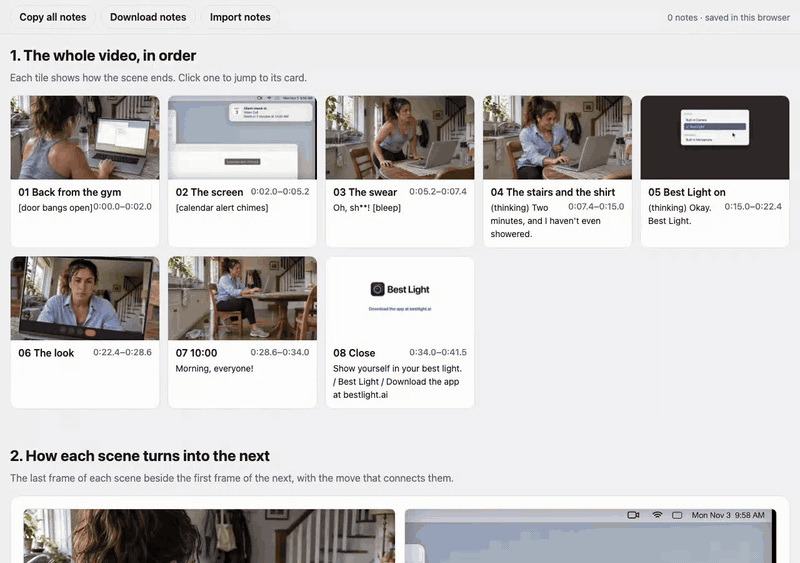
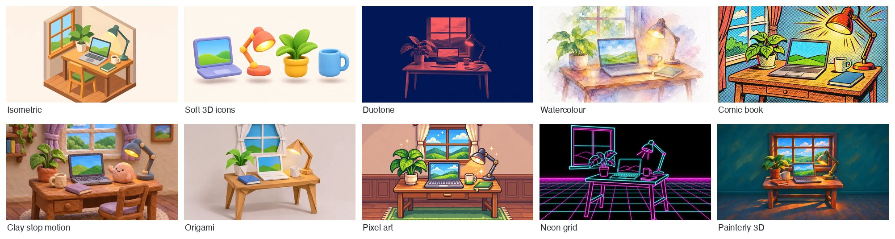
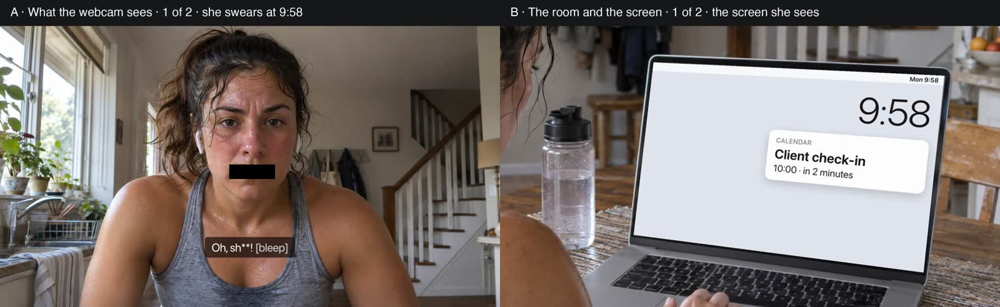
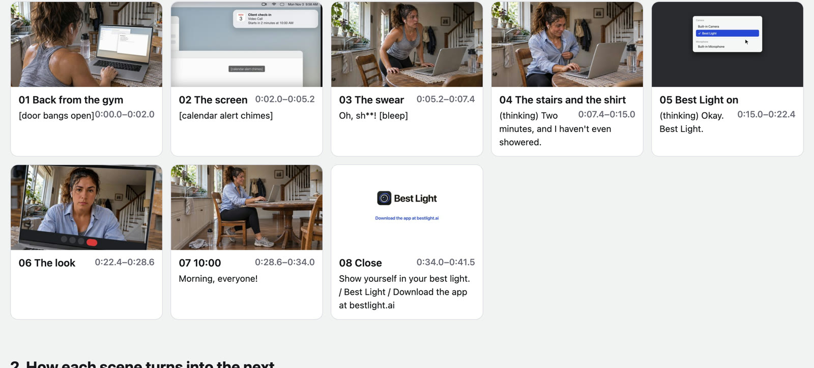
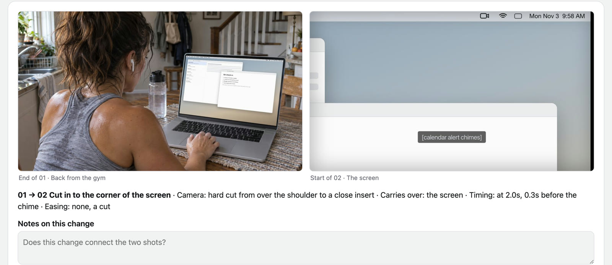
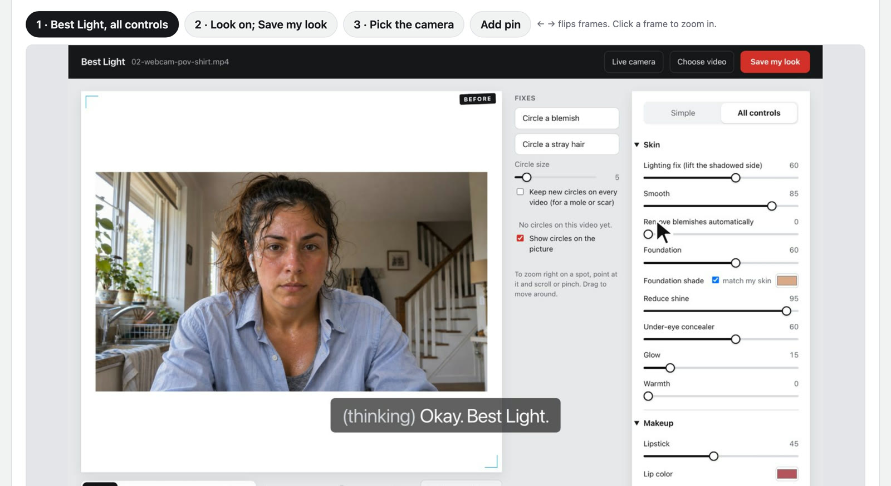
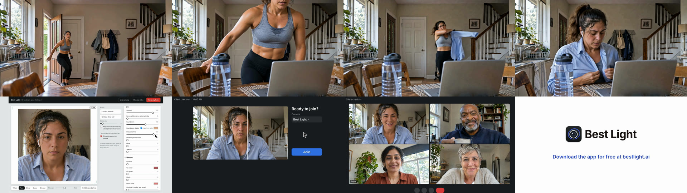

# Video Director

**A Claude Code skill that directs short videos from brief to finished render.** Product launch films, explainers, brand films, designed demos, vertical social shorts, event and data videos, and live-action story ads, from about 6 seconds to 3 minutes, mixing motion graphics with photos, footage and generated clips.

You direct; Claude designs and builds. Nothing is animated until you have approved it as still frames, and every visual decision is a pick from 2-3 real options, never a reaction to one take.



*The storyboard and film examples on this page are from a real project: a 52-second ad for [Best Light](https://bestlight.ai), a Mac webcam app. All the people in it are AI-generated.*

## What's inside

- **Rules measured from real films, not guessed.** Text sizes, positions, reading times and motion rules come from measuring 59 films across seven types. The visual ideas come from studying 34 films and ads. The lessons from building real films were checked against 56 more before they became rules.
- **8 video types**, each with its own defaults, films worth studying, and a "default versus better" table: product launch, explainer, brand film, demo or tutorial, social short, event, recap or data, showcase, and live-action story.
- **57 animation styles** in five groups (motion design; drawn and illustrated; paper, craft and physical; graphic and type-led; 3D and texture), each with an example picture and a film to look up.
- **A zoomable storyboard page** you can pin notes to, a motion spec with a named move, timing and easing for every change, and an animated test before the full build.
- **Sound made by film type.** Live-action films take their sound and spoken lines from the video model, checked with speech-to-text. Motion-design films get a few real recorded effects. Every film's music is fitted to the cut on its bar lines (`scripts/fit_music.py`). Every sound file is listed with its source and licence, and `scripts/check_sources.py` checks the list.
- **A sound engineering step for effects.** Every sound is planned with the motion spec, one moment at a time. The scripts of [real-sfx](https://github.com/Clipwing/skills/tree/main/skills/real-sfx) by Clipwing, built into Video Director, place a real recording from your own sound library on each planned frame. `scripts/sound_handoff.py` hands them the plan and brings the effects track back. It checks every sound against the plan (nothing missing, nothing extra, nothing off its frame) and fills in the sources list. Then the levels are measured against the music, and you listen.
- **Render checks** in Python: frames on both sides of every cut, choppy motion, text size and reading time by role, sound levels, continuity between shots, delivery specs, and an optional motion watch by a video model.

## How it works

**1. Brief and script.** It asks what the film is for, who it's for, what tools you have, and whether to study reference films or build from scratch.

**2. Pick a style.** For a film with motion graphics, Claude builds a page with a picture of every animation style and puts the 3-4 that suit your film at the top. Pick one or more, describe the look you want in your own words, or say "you choose". Every picture shows the same desk by a window, so the styles are easy to compare.



The pictures were made for the library with image generation; they show a look, not how a film moves. All 57 are in [`skills/video-director/assets/style-library/`](skills/video-director/assets/style-library/).

**3. Direction options.** Before any storyboard, you pick a direction from 2-3 labeled still frames of the same moment.



**4. The storyboard page.** One HTML page you open in a browser. It shows the whole film in order, with each tile showing how its scene ends.



It shows every change between scenes, side by side, with the move that connects them: the camera, what carries over, the timing and the easing.



Then it shows each scene as a card. Flip through its frames, zoom in, pin numbered notes to any spot, and copy or download every note to hand back to Claude.



**5. Motion spec and sound plan.** Every change on screen gets a named move, timing and easing before anything is animated. The sound is planned at the same time: where each sound comes from, and Suno prompts for the music.

**6. Animated test, then the full film**, with its sound, built with [HyperFrames](https://github.com/heygen-com/hyperframes).

**7. Render checks and polish rounds** until you sign off.



## Install

In Claude Code:

```
/plugin marketplace add SallyRS/video-director
/plugin install video-director@video-director
```

Or copy `skills/video-director/` into `~/.claude/skills/`.

## Needs

- Python 3 and [ffmpeg](https://ffmpeg.org/) for the render checks.
- [HyperFrames](https://github.com/heygen-com/hyperframes) for the build.
- Optional: [yt-dlp](https://github.com/yt-dlp/yt-dlp) to study reference films, a clip tool such as [Higgsfield](https://higgsfield.ai/) for generated footage, [Codex](https://github.com/openai/codex) for stills, and a [Gemini API](https://ai.google.dev/) key for the motion watch (`scripts/watch_cut.py`). The skill works without them and says what it can't check.
- Optional, for sound: [Suno](https://suno.com/) for music (a paid plan for anything commercial), [whisper.cpp](https://github.com/ggml-org/whisper.cpp) to check what generated clips say, [aubio](https://aubio.org/) or [librosa](https://librosa.org/) to find a track's bar lines, and your own sound library for the included real-sfx (it needs ffmpeg with the `drawtext` and `rubberband` filters, on macOS Homebrew's `ffmpeg-full`, and numpy for some scripts). Its settings live in `~/.config/real-sfx/`, so plugin updates keep them.

The only sound files included are real-sfx's interface pack (uisfx, CC0). Sounds from the free libraries aren't included: their licences don't allow sharing the files on their own. `references/sound-stage.md` lists where to get sounds and what each licence allows.

## Credits

Built on and informed by other people's open work:

- **[HyperFrames](https://github.com/heygen-com/hyperframes)** by HeyGen: the HTML-to-video engine every film is built with.
- **[motion-video-kit](https://github.com/echris6/motion-video-kit)** by echris6 (MIT): its measured rules from professional launch films shaped how this skill carries objects across cuts and treats reference films as something to measure, not imitate.
- **[saas-motion-kit](https://github.com/tugrawork-creator/saas-motion-kit)** by tugrawork-creator (MIT): its variety rules for shot length, easing and transitions in HyperFrames films.
- **[motionmaxxing](https://github.com/Tejashmakwana/motionmaxxing)** by Tejashmakwana (Apache-2.0): the finding that a gallery of example films makes every brand look the same, which is why this skill pairs a default with a better decision instead.
- **[onetake](https://github.com/feitangyuan/onetake)** by feitangyuan: its numbers on rhythm and what carries across a cut. Ideas only; no text or code is used.
- **[real-sfx](https://github.com/Clipwing/skills/tree/main/skills/real-sfx)** by Alexander Korbanov at [Clipwing](https://clipwing.pro) (MIT): its scripts are kept in `skills/video-director/real-sfx/`, and Video Director's sound engineering step runs them. What Video Director needs from real-sfx's instructions is written into its own `references/real-sfx-scripts.md` and `references/sound-stage.md`, with Video Director's sound defaults. Clipwing's README gives the scripts as MIT, so the folder carries the standard MIT text in `LICENSE`. `real-sfx/UPSTREAM.md` records the Clipwing version the scripts came from and every change made here; `tools/sync-real-sfx.sh` brings in Clipwing's later script changes, keeping the changes made here, and lists changes to Clipwing's instructions for a person to review. Its interface sounds are [uisfx](https://www.npmjs.com/package/uisfx) by Yuki Capital (code MIT, sounds CC0), with their own licence files.
- **[DirectorSKILL](https://github.com/wuwangzhang1216/DirectorSKILL)** by wangzhang-wu (MIT): the planning rules for generated clips in `skills/video-director/references/generated-clips.md` (actions clip models get wrong, cuts between generated shots, continuity before generating, clips that keep failing, physical products, two people talking) are adapted from it and rewritten in this skill's words.
- **[Jesse Eisenbart's 20-style showcase](https://www.tiktok.com/@jesseeisenbart/video/7697657520793324818)**: the starting point for the animation style list.

The films named inside the skill are cited as examples to study. No footage, layouts or brand looks from them are included.

## License

MIT
